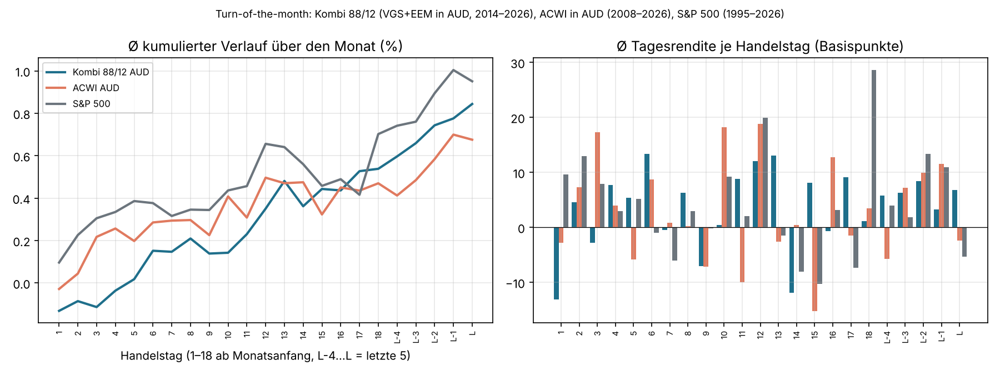

# Bester Kauftag im Monat? (Stand 4.11.2026)

Frage (Nico, 4.11.2026): Ist der 18.–23. eines Monats historisch der beste Kauftag, also Auto-invest am 19.?

## Methode
- Tagesschlusskurse von TradingView, abgerufen am 4.11.2026: ASX:VGS (≈ BGBL, MSCI World ex AU, in AUD, ab 11/2014), AMEX:EEM (Schwellenländer, per FX:AUDUSD in AUD umgerechnet), NASDAQ:ACWI in AUD (ab 3/2008) und SP:SPX (ab 1/1995).
- **Produktkombi:** 88 % VGS + 12 % EEM in AUD, täglich rebalanciert, als Proxy für 88 BGBL / 12 BEMG. BGBL gibt es erst seit 5/2023 und BEMG seit 8/2025, beide Reihen sind zu kurz.
- Für jeden Kalendertag d = 1…28 und jeden Monat wird am ersten Handelstag ab d gekauft. Gemessen wird, wie viele Anteile man im Schnitt mehr bekommt als am durchschnittlichen Kauftag desselben Monats.
- **Rohwert** = so, wie die Kurse waren. **Trendbereinigt** = ohne den normalen Aufwärtstrend (~9 % p. a.). Ohne Bereinigung gewinnt fast automatisch der Monatsanfang, weil die Kurse im Schnitt steigen. Das ist aber kein Kalendereffekt, das ist nur „früher investiert“.
- Skript: [`models/kauftag_analyse.py`](../../models/kauftag_analyse.py)

## Ergebnis (mehr Anteile in % gegenüber dem Durchschnittstag)

| Reihe | Monate | Tag 1–3 roh | Tag 18–23 roh | Tag 19 roh | Trendbereinigt: 18–23 vs. 1–3 | t-Wert |
|---|---|---|---|---|---|---|
| **Kombi 88/12, AUD** | 143 | +0,39 | −0,14 | −0,14 | **−0,07** | −0,28 |
| ACWI, AUD | 223 | +0,33 | −0,08 | −0,21 | +0,07 | 0,32 |
| S&P 500, USD | 381 | +0,31 | −0,06 | −0,16 | −0,04 | −0,21 |

Trendbereinigt liegt jeder Kalendertag bei der Kombi innerhalb von **±0,11 %**. Der „beste“ Tag springt je nach Reihe und Zeitraum (Kombi: 4., ACWI: 24., S&P: 1.).

## Lesart
1. **Ein Effekt „18.–23. ist am besten“ zeigt sich nicht.** Roh ist das Fenster sogar ca. 0,5 % schlechter als der Monatsanfang, trendbereinigt liegt es bei null (t ≈ 0,3, also Rauschen). Konfidenz 85 %.
2. Der bekannte Turn-of-the-month-Effekt (höhere Renditen vom letzten bis 3. Handelstag) ist in den Tagesrenditen sichtbar, z. B. S&P 6,8 statt 2,7 Basispunkte pro Tag. Er ist aber zu klein und zu instabil, um einen Kauftag zu bevorzugen.
3. Wirtschaftlich: Selbst 0,1 % besserer Einstieg pro Rate wären bei $400/Monat über 30 Jahre (7 %) ca. **$470 von ~$470.000**. Das ist irrelevant.
4. Was zählt: **Geld so früh wie möglich investieren, nachdem es da ist.** Der Kauftag sollte deshalb kurz nach dem Geldeingang liegen und nicht auf ein Kalenderfenster warten.

## Empfehlung
Der 19. ist okay. Er kostet nichts Messbares und bringt nichts Messbares. Entscheidend ist, dass Überweisung und Kauf zuverlässig zusammenpassen (ANZ-Dauerauftrag am 17., Auto-invest am 19.).

Grenzen: 12 Jahre für die Kombi, kein Out-of-Sample-Test der Fenster, Schlusskurse statt der tatsächlichen Ausführungskurse von Betashares Direct, EEM nur als BEMG-Proxy.

## Nachtrag 5.11.2026: Saisonalität über den Monat (Turn-of-the-month) und Open vs. Close

Durchschnittliche Tagesrendite je Handelstag (1. bis 18. Handelstag und letzte 5 Handelstage, L = letzter):

| | Ø alle Tage | Letzter + erste 3 HT | Rest | t-Wert | Anteil an Gesamtrendite (bei 19 % der Tage) |
|---|---|---|---|---|---|
| Kombi 88/12, AUD (ASX-Handelstage) | 3,7 bp | −0,8 bp | 4,7 bp | −1,5 | −4 % |
| ACWI, AUD | 3,0 bp | 4,9 bp | 2,5 bp | 0,5 | 31 % |
| S&P 500 | 3,5 bp | 6,3 bp | 2,8 bp | 1,1 | 34 % |

- Die Kurve ist im Kern eine Gerade (Drift ~0,7–0,9 % pro Monat). Es gibt keine Delle zur Monatsmitte, auf die man warten könnte.
- Der klassische Turn-of-the-month-Effekt ist im S&P 500 und ACWI sichtbar, aber statistisch schwach (t ≈ 0,5–1,1). In der ASX-gehandelten Kombi fehlt er ganz, auch weil ASX-Kurse die US-Sitzung einen Tag versetzt abbilden.
- Kauf am 23. (≈ 15./16. Handelstag) liegt vor den letzten 5 Handelstagen. Wenn der Effekt existiert, ist das die richtige Seite. Der Vorteil liegt aber im Rauschen.

**Open vs. Close (VGS an der ASX, 3.026 Tage, 2014–2026):** Close→Open +13,0 bp, Open→Close −9,2 bp (t ≈ ±9,5, in beiden Hälften des Zeitraums stabil). Der Eröffnungskurs lag im Schnitt etwa 0,1 % über dem Schlusskurs desselben Tages. Ein Kauf zum Close war deshalb günstiger als zum Open, sowohl am selben Tag als auch gegenüber dem Open am nächsten Morgen. Konfidenz 70 %: TradingView-Opens sind erste Trades in einer illiquiden Eröffnungsphase. Genau das ist aber der Preis, den eine Marktorder zur Eröffnung zahlt.

Skript: [`models/turn_of_month.py`](../../models/turn_of_month.py)
